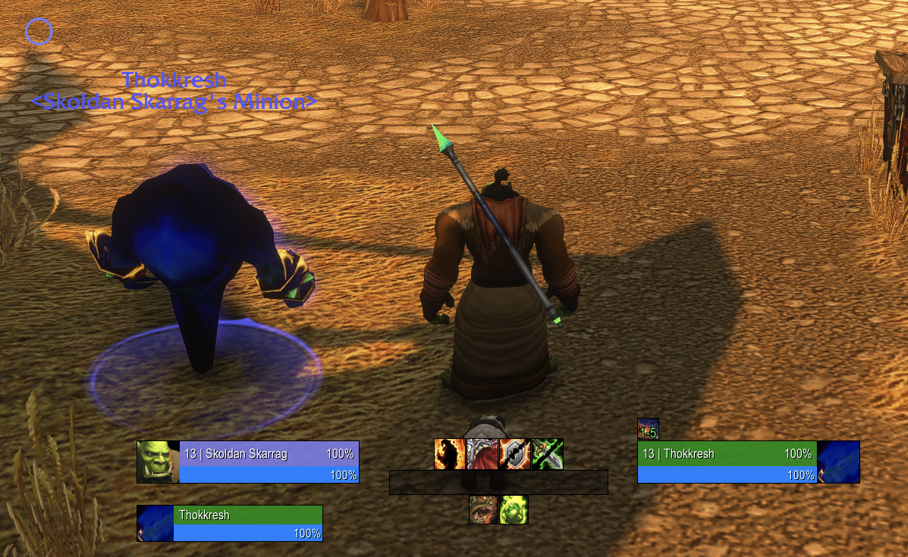
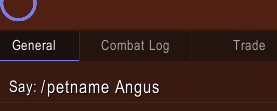
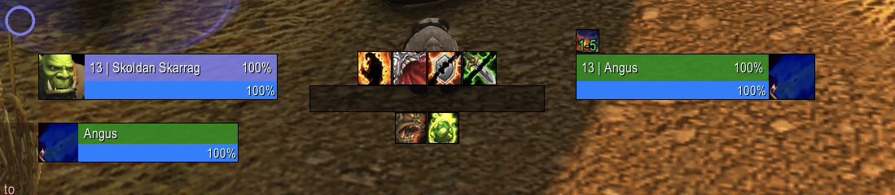
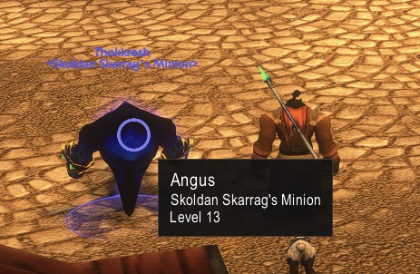

# PetNickname

Your Voidwalker is called Thokkresh? You would rather call him Angus? Now you can!

PetNickname gives your pet a nickname that only you can see. Made for warlocks who want something better than the name the game rolled for their demon, but it works for any pet.

Built for WoW Forever (interface 16001).

## Before and after

Before: the game calls him Thokkresh.



```
/petname Angus
```



After: he is Angus on your unit frames and in his tooltip.





## Usage

Summon your pet, then:

| Command | What it does |
|---|---|
| `/petname Angus` | Your current pet is now called Angus |
| `/petname reset` | Angus goes back to his real name |
| `/petname list` | Lists all nicknames on this character, for example `Thokkresh is called Angus` |
| `/petname` | Shows the current pet's nickname |

Nicknames are saved per character and keyed by the pet's real name, so your Imp, Voidwalker and Succubus each keep their own. Only one of them gets to be Angus, though.

## Where Angus shows up

- Unit frames: pet, target, target of target, focus and focus target. Works with Blizzard's default frames, EllesmereUI and other unit frame addons.
- His nameplate, if you show nameplates for your pet
- The unit tooltip

PetNickname does not need to know your unit frame addon. It looks for frames that show a unit and swaps the pet's real name for the nickname in their text, nothing else.

## Limits

- The floating name above the pet in the game world is drawn by the game engine. No addon can change it, so out there he stays Thokkresh (see the first screenshot).
- Combat log and chat messages keep the real name.
- The nickname is client side only. Other players still see Thokkresh. Angus is your little secret.

## License

MIT, see [LICENSE](LICENSE).
